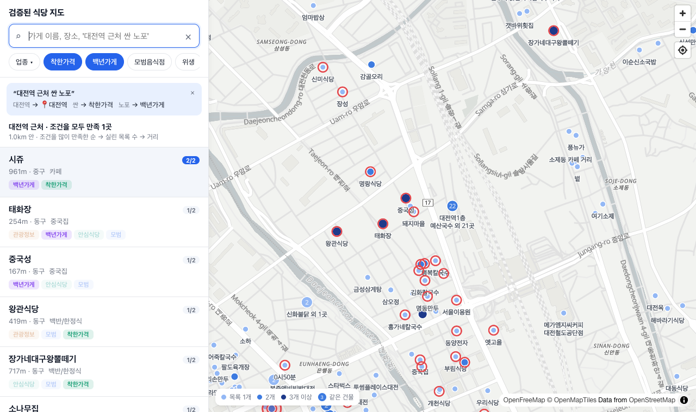

# certmap — 검증된 식당 지도

공공기관이 인증·추천한 식당만 지도에 보여주는 서비스예요. 맛 점수는 없어요. **"맛있다"가 아니라 "어떤 공공 목록에 실렸는지"** 만 보여줘요.



> "대전역 근처 싼 노포" → 📍대전역 · 착한가격 · 백년가게로 읽고, 조건을 많이 만족한 순으로 보여줘요. 둘 다 만족하는 곳은 1곳뿐이라 다 만족하는 곳만 보여주면 목록이 거의 비어요. 그래서 가게마다 무엇을 만족했는지(2/2, 1/2)를 같이 보여줘요.

## 무엇을 하나

공공 인증 목록 7종을 소상공인 상가정보 277만 곳과 **같은 가게끼리 이어 붙여요.** 그러면 "착한가격업소이면서 백년가게인 곳"처럼 여러 목록을 겹쳐 볼 수 있어요.

| 공공 목록 | 건수 | 성격 |
|---|---|---|
| 모범음식점 | 11,560 | 지자체 지정 |
| 착한가격업소 | 9,709 | 행정안전부 |
| 백년가게 | 1,511 | 중소벤처기업부 |
| 식품안심업소 | 44,977 | 식품의약품안전처 위생 인증 |
| 안심식당 | 744 | 농림축산식품부 (지금은 대전만) |
| 관광공사 관광정보 | 13,408 | 인증이 아니라 관광 안내용 편집 목록 |
| LX 직원 추천 | 2,013 | 인증이 아니라 한국국토정보공사 직원 추천 |

출처·내려받은 날짜·거른 기준은 [data/README.md](data/README.md)에 있어요.

## 숫자로 본 결과

### 1. 매칭: 서로 다른 기관의 목록을 같은 가게로 잇기

공통 번호가 없어서 이름과 주소로 이어야 해요. 같은 가게를 기관마다 `할머니순대국` / `할머니 순대국밥` / `할머니순대국(본점)`처럼 다르게 적어요.

- **방법:** 같은 건물(도로명 + 건물번호)에 있는 상가 가게 중에서 이름·업종 규칙으로 골라요. 지점명이 다르면 다른 가게로 봐요(`OO 강남점` ≠ `OO 역삼점`).
- **채점:** 구간별로 뽑은 정답지 두 벌(개발용 300건, 시험용 300건)로 쟀어요. 시험용은 규칙을 다 고친 뒤 한 번만 채점했어요.

| 규칙 | 정밀도 | 재현율 | 놓친 몫 |
|---|---|---|---|
| v0 | 98.9% | 94.0% | 5.0% |
| **v1 (서비스)** | **99.7%** (95% 구간 99.4~100) | **95.6%** | **3.6%** |

- 놓친 몫이 미리 정한 기준(5%) 아래라서, 서비스에는 **AI 매칭을 넣지 않았어요.**
- 상가에서 못 찾은 인증 2만 건은 같은 건물 안에서만 서로 묶어서 새 가게로 만들었어요. 건물을 넘어 묶으면 잘못 묶인 게 번지기 때문이에요.
- 결과는 가게 860,695곳이고, 그중 인증이 붙은 가게가 78,365곳이에요.

### 2. 지도: 점 7.8만 개 그리기

PostGIS가 지도 타일마다 점을 압축(벡터 타일)해서 주고, MapLibre가 GPU로 그려요.

| 도 단위(z7) 타일 한 장 | 크기 |
|---|---|
| 가게를 하나하나 넣으면 | 점 28,863개, **2.6MB** |
| 격자로 묶으면 | **1.3KB** (약 1,900분의 1) |

- z12까지는 묶고, z13부터 가게 하나하나를 보여줘요.
- 상가 좌표는 건물 단위라 인증 가게의 27%가 다른 가게와 좌표가 같아요. 그래서 같은 좌표는 점 하나로 묶고 "이 건물의 가게 22곳" 목록으로 열어요. 점을 흩어 그리면 없는 위치를 지어내게 돼서 그렇게 하지 않았어요.

### 3. 검색

- **이름 검색:** Postgres 기본 기능(pg_trgm)을 86만 개 이름으로 먼저 재봤어요. trigram(글자 3개 묶음)은 영어용이라 한국어 두 글자 검색이나 짧은 이름 오타에 약했어요. 1차는 위치 색인의 "가까운 순으로 꺼내기"와 합쳐서 가볍게 갔어요. 흔한 두 글자(`국밥`)도 0.8ms예요.
- **문장 검색:** "싼 → 착한가격, 노포 → 백년가게, 대전역 → 장소"처럼 단어 사전 규칙이 문장을 조건 칩으로 바꿔요. 가게는 언제나 DB에서 나와서 없는 가게를 지어낼 수 없어요. 사전에 없는 말("분위기", "조용한")은 숨기지 않고 "반영 못 함"으로 보여줘요.
- **"맛집":** 특정 목록(LX 추천)만 맛집으로 치지 않아요. "여러 공공 목록에 실린 가게일수록 위"로 정렬해요.

### 4. 의미 검색 (진행 중)

"분위기 좋은", "데이트하기 좋은"처럼 인증 목록에 없는 정보는 관광공사 소개글에서 찾아요. 소개글을 임베딩해서 pgvector로 검색해요. 모델은 서버 안에서 돌아서 키나 비용이 없어요.

| 모델 | 검색어 응답 | 서버 메모리 | 정밀도@5 |
|---|---|---|---|
| multilingual-e5-small | 1.9ms | 614MB | 판정 중 |
| multilingual-e5-base | 2.8ms | 1,050MB | 판정 중 |
| bge-m3 | 6.5ms | 1,401MB | 판정 중 |

모델이 클수록 배포 서버가 커져요(1GB → 2GB). 그래서 정확도가 그만큼 오르는지 사람이 판정한 시험지로 정할 거예요. 세 모델의 상위 5곳은 평균 1곳만 겹쳐요.

## 구조

```
원본 CSV/API ──▶ scripts/ (파이썬)       전처리 · 매칭 · 정답지 · 채점
                    │  CSV 6개
                    ▼
               packages/db (TS)          COPY → staging → SQL 변환 (트랜잭션, 건수 검사)
                    │
                    ▼
     PostgreSQL + PostGIS + pgvector     가게 · 인증 · 소개글 벡터
                    │
                    ▼
               apps/server (Hono)        벡터 타일 · 검색 · 조건 · 문장 해석
                    │  타입 공유 (Hono RPC)
                    ▼
               apps/web (React + MapLibre)
```

- **CSV까지는 파이썬, DB부터는 TS예요.** 전처리·매칭은 시험지로 검증까지 끝난 코드라 옮기지 않았어요.
- 서버와 화면은 같은 타입을 써서, 서버 응답 모양이 바뀌면 화면 쪽 타입 검사가 잡아내요.

## 실행

준비물: Docker, Node 22 + pnpm, Python 3.

```bash
docker compose up -d                       # Postgres + PostGIS + pgvector
pnpm install

# 데이터 (원본은 data/README.md 를 보고 data/raw/ 에 받아 둔다)
python3 scripts/prep_sangga.py
python3 scripts/prep_certs.py
python3 scripts/match_all.py
python3 scripts/match_stage2.py
python3 scripts/prep_tour_detail.py
pnpm db:load                               # DB 채우기 (약 40초)
pnpm db:embed                              # 소개글 벡터

pnpm dev:server                            # http://localhost:8790/api
pnpm dev:web                               # http://localhost:5173
```

원본 데이터와 가공본(약 800MB)은 저장소에 올리지 않았어요. 정답지(`data/labels`)와 결과(`results`)는 올렸어요.

## 결정 기록

무엇을 왜 그렇게 했는지, 버린 선택지와 실패한 시도까지 [docs/decisions.md](docs/decisions.md)에 번호를 붙여 적었어요. 예를 들면 이런 것들이에요.
- 3번: 인증끼리 먼저 합치지 않고 상가에 하나씩 붙인 이유
- 18번: AI 매칭을 서비스에서 뺀 이유
- 32번: "맛집 = LX 추천"을 뒤집은 이유

## 한계

- **정답지 라벨:** 매칭 정답지는 AI 3명(모두 Claude 계열)이 독립적으로 라벨링하고 다수결로 정했어요(일치도 카파 0.96~0.97). 사람 검수는 아직 안 했어요. 같은 계열 AI끼리라 함께 틀렸을 수 있어요.
- **LX 정밀도:** LX 추천 목록은 정답지를 만든 뒤에 추가해서 매칭 정밀도를 따로 재지 않았어요.
- **위치:** 상가 좌표가 건물 단위라 같은 건물의 가게는 같은 자리에 찍혀요. 좌표가 없는 가게 2,078곳은 지오코딩을 기다리고 있어요.
- **소개글:** 관광공사 소개글은 하루 한도 때문에 매일 나눠 받는 중이에요. 소개글이 있는 가게(관광공사 목록)만 의미 검색에 걸려요.

## 데이터 출처

공공데이터포털(data.go.kr)과 소상공인시장진흥공단 상가(상권)정보예요. 바탕 지도는 © [OpenStreetMap](https://www.openstreetmap.org/copyright) 기여자, [OpenFreeMap](https://openfreemap.org)이에요.
